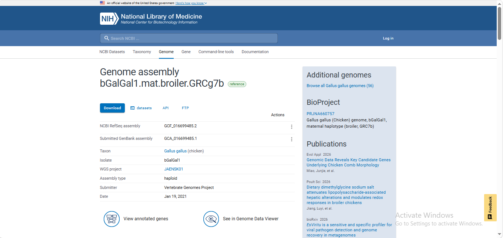
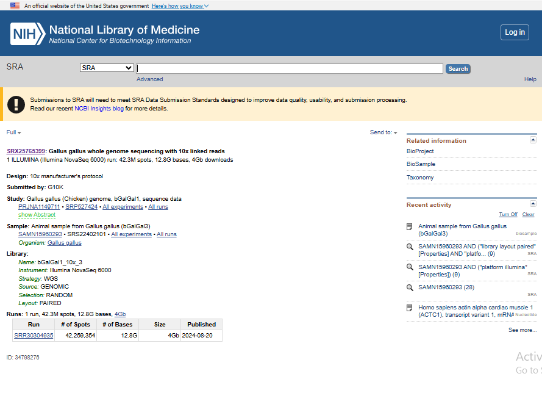
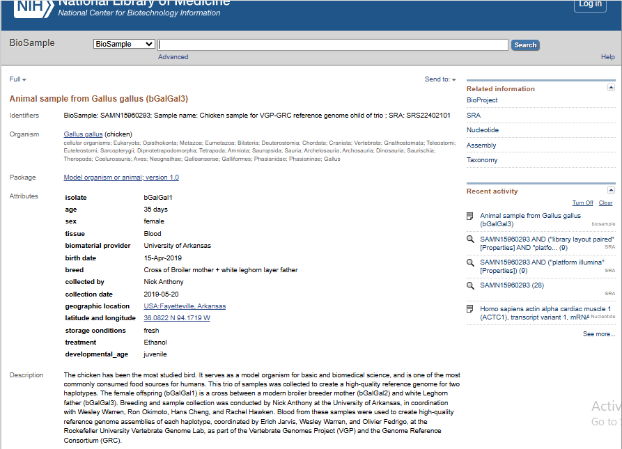
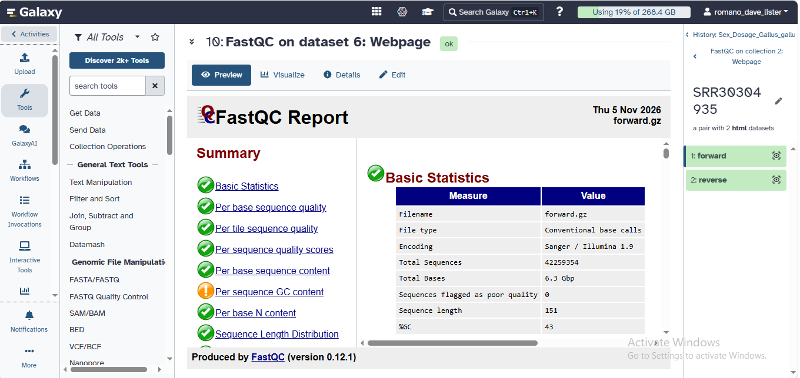
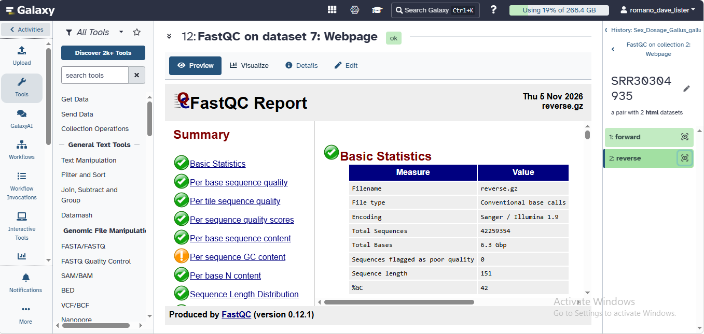
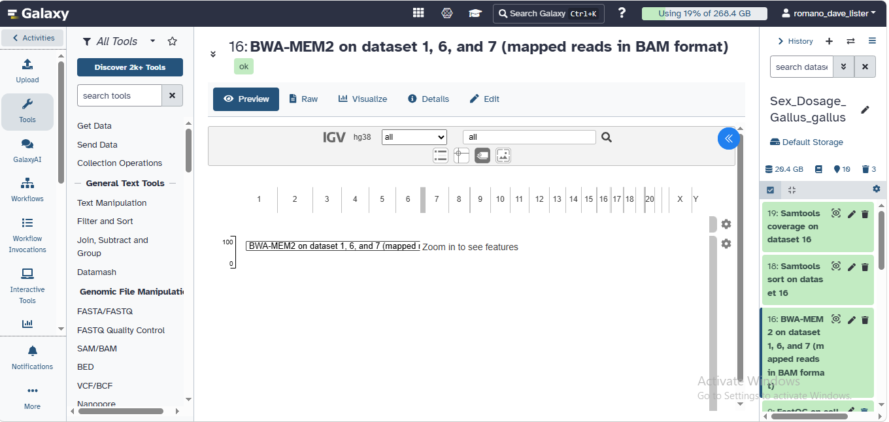
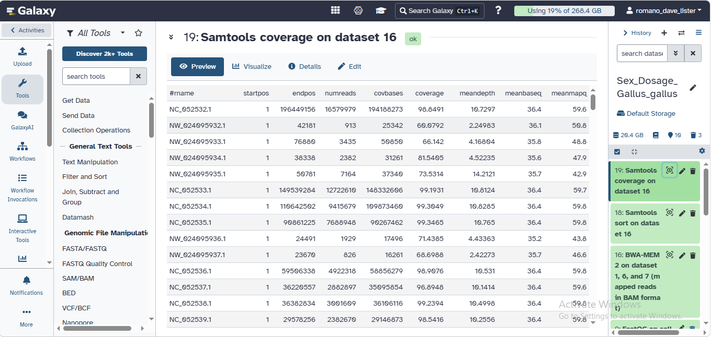
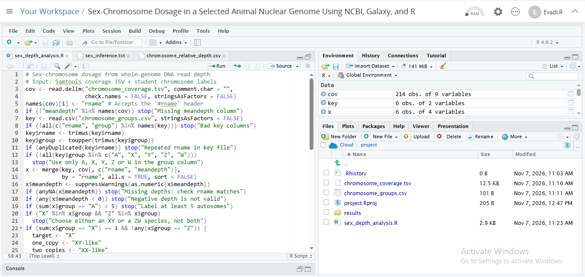
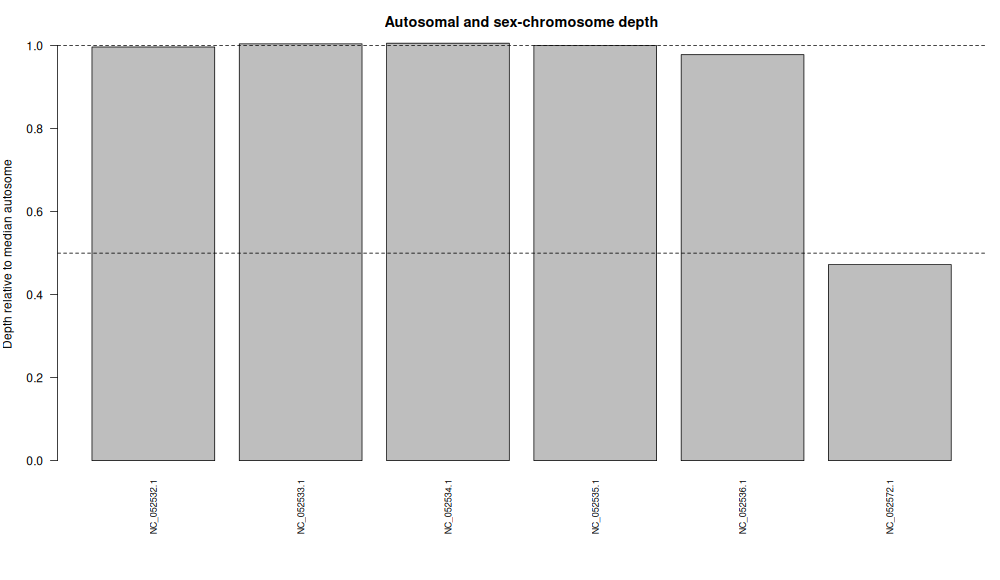

# Sex-Chromosome Dosage in the Chicken (*Gallus gallus*)

### Name: Dave Lister F. Romano

**Study question:** Does the Z-chromosome read depth, relative to the autosomes, show that the chicken that supplied the WGS reads is ZW-like or ZZ-like?

## Part A. Species and data

| **Item** | **Value** |
|---|---|
| Name | Dave Lister F. Romano |
| Section | A |
| Animal species | *Gallus gallus* (chicken) |
| Assembly accession | [GCF_016699485.2](https://www.ncbi.nlm.nih.gov/datasets/genome/GCF_016699485.2/) |
| Assembly BioSample | [SAMN15960293](https://www.ncbi.nlm.nih.gov/biosample/SAMN15960293) |
| Sex system (XY/ZW) | ZW |
| WGS run accession | [SRR30304935](https://www.ncbi.nlm.nih.gov/sra/SRR30304935) |
| WGS BioSample | [SAMN15960293](https://www.ncbi.nlm.nih.gov/biosample/SAMN15960293) |
| Same donor? | Yes |
| Status | Verified |

## Part B. Galaxy workflow

1. Created history Sex_Dosage_*Gallus_gallus* in Galaxy.
2. Uploaded the chicken reference genome: GCF_016699485.2_bGalGal1.mat.broiler.GRCg7b_genomic.fna.
3. Downloaded WGS run SRR30304935 using Faster Download and Extract Reads in FASTQ (paired-end data).
4. Ran FastQC on the forward (R1) and reverse (R2) reads. The reports indicated that trimming was not needed.
5. Mapped the paired-end reads using BWA-MEM against the uploaded chicken reference genome (GCF_016699485.2).
6. Used Samtools sort to sort the alignment output by coordinate.
7. Used Samtools index to create an index for the sorted BAM file.
8. Ran Samtools coverage on the sorted BAM file to calculate chromosome-level read depth.
9. Downloaded the coverage output as chromosome_coverage.tsv.

## Part C. Chromosome groups

File: [chromosome_groups.csv](YOUR_GITHUB_FILE_LINK)

| **rname** | **Group** | **Reason** |
|---|---|---|
| NC_052532.1 | A | Chromosome 1 in the NCBI sequence report (assembled molecule) |
| NC_052533.1 | A | Chromosome 2 in the NCBI sequence report (assembled molecule) |
| NC_052534.1 | A | Chromosome 3 in the NCBI sequence report (assembled molecule) |
| NC_052535.1 | A | Chromosome 4 in the NCBI sequence report (assembled molecule) |
| NC_052536.1 | A | Chromosome 5 in the NCBI sequence report (assembled molecule) |
| NC_052572.1 | Z | Labeled Z in the NCBI sequence report (assembled molecule) |

The sequence names were copied from the rname column of chromosome_coverage.tsv and checked against the NCBI sequence report for assembly GCF_016699485.2. Five autosomes and the Z chromosome were selected for the dosage analysis. Unplaced scaffolds, mitochondrial DNA, and other non-chromosomal sequences were excluded. The W chromosome was not included in the analysis.

## Part D. R analysis

- Script: [View the R analysis script](sex_depth_analysis.R)
- Inputs: chromosome_coverage.tsv, chromosome_groups.csv
- Outputs:
  - results/chromosome_relative_depth.csv
  - results/sex_inference.txt
  - results/chromosome_depth.png

The R script reads the chromosome coverage data and chromosome group assignments, calculates the median autosomal sequencing depth, and determines the relative depth of the Z chromosome. It then calculates the Z:A ratio and provides a dosage interpretation based on the classroom cutoffs.

**Results:**
- Median autosome depth: **10.765**
- Z:A ratio: **0.473**
- W:A ratio: **NA**
- Dosage interpretation: **ZW-like**

## Part E. Results and interpretation

| **Result** | **Value** |
|---|---|
| Median autosomal depth | 10.765 |
| Z:A ratio | 0.473 |
| W:A ratio | NA (not available in the analysis) |
| Interpretation | ZW-like |

The Z:A ratio was calculated using the mean depth of the Z chromosome divided by the median depth of the selected autosomes.

| **rname** | **Group** | **Mean depth** | **Relative depth** |
|---|---|---:|---:|
| NC_052532.1 | A | 10.7297 | 0.996720854621458 |
| NC_052533.1 | A | 10.8124 | 1.00440315838365 |
| NC_052534.1 | A | 10.8285 | 1.0058987459359 |
| NC_052535.1 | A | 10.765 | 1 |
| NC_052536.1 | A | 10.531 | 0.978262888992104 |
| NC_052572.1 | Z | 5.08653 | 0.472506270320483 |

The Z:A ratio of 0.473 is close to the expected value of 0.5 for a ZW individual. Based on the classroom cutoff (0.65 or lower), the WGS chicken sample is classified as ZW-like. The assembly and WGS data share the same BioSample accession, SAMN15960293. However, the recorded sex of the WGS donor should be checked in the NCBI BioSample metadata before making a direct comparison. The W:A ratio was not available, so the result is based on Z-chromosome read depth relative to autosomal depth.

The Z:A ratio of 0.473 is below the 0.65 cutoff and close to the expected value of 0.5, so the WGS chicken sample is ZW-like. This is consistent with the expected ZW sex-chromosome complement in female chickens. The assembly and WGS data share the same BioSample accession, SAMN15960293, but the recorded sex in the BioSample metadata should still be checked for confirmation. Matching metadata is validation and does not replace the sequence evidence.

## Questions for the Report

### 1. What species did you choose, and what evidence supports a diploid XX/XY or ZZ/ZW system?

I chose the chicken (*Gallus gallus*), which has a diploid ZZ/ZW sex-chromosome system. In chickens, males normally have ZZ chromosomes, while females normally have ZW chromosomes. The selected reference assembly also identifies a Z chromosome, supporting the use of the Z:A depth ratio for this analysis.

### 2. What are your assembly accession, WGS run, and both BioSample accessions? Are the donors the same?

The assembly accession used was GCF_016699485.2, and the WGS run accession was SRR30304935. Both the assembly and WGS data have the same BioSample accession, SAMN15960293. Therefore, based on the provided dataset information, they represent the same donor.

### 3. Which sequences were used as autosomes and as X or Z? How did you verify their identities?

I used five autosomal sequences and one Z chromosome sequence for the analysis. The chromosome identifiers were:

| **Sequence identifier** | **Group** |
|---|---|
| NC_052532.1 | Autosome (A) |
| NC_052533.1 | Autosome (A) |
| NC_052534.1 | Autosome (A) |
| NC_052535.1 | Autosome (A) |
| NC_052536.1 | Autosome (A) |
| NC_052572.1 | Z chromosome |

I identified and classified these sequences using the NCBI assembly sequence report for GCF_016699485.2 and matched their identifiers with the rname column in my chromosome coverage file.

### 4. What are the median autosomal depth, X:A or Z:A ratio, and inferred sex-chromosome complement?

The median autosomal sequencing depth was **10.765**, and the calculated Z:A ratio was **0.473**. Since the ratio is close to the expected value of 0.5 for a ZW individual, the inferred sex-chromosome dosage pattern is **ZW-like**. The W:A ratio was reported as NA in the analysis.

### 5. Does your result agree with the recorded sex of the WGS donor, if reported? Explain any discrepancy or uncertainty.

The analysis produced a ZW-like result, which is consistent with the normal female chromosome complement in chickens. The assembly and WGS data share the same BioSample accession, SAMN15960293. However, the dataset information available to me does not explicitly show the donor's recorded sex, so I cannot confirm a direct comparison with the BioSample sex metadata. The result should also be interpreted cautiously because sequencing depth, mapping bias, repetitive regions, and reference genome limitations can affect chromosome coverage.

### 6. Why is a chromosome-level assembly alone insufficient for a reliable read-depth sex inference?

A chromosome-level assembly alone is insufficient because it only provides the reference genome sequences and does not show how many sequencing reads came from each chromosome. Read-depth analysis requires actual WGS sequencing reads that are aligned to the reference genome. The coverage of the sex chromosomes must then be compared with autosomal coverage to calculate the X:A or Z:A ratio. Factors such as low read depth, mapping bias, repetitive regions, and missing or incomplete sex-chromosome sequences can also affect the result.

## References

1. National Center for Biotechnology Information (NCBI). (2021). *Gallus gallus: bGalGal1.mat.broiler.GRCg7b genome assembly (GCF_016699485.2).* NCBI Genome.  
   https://www.ncbi.nlm.nih.gov/datasets/genome/GCF_016699485.2/

2. National Center for Biotechnology Information (NCBI). *BioSample: SAMN15960293.*  
   https://www.ncbi.nlm.nih.gov/biosample/SAMN15960293/

3. National Center for Biotechnology Information (NCBI). *Sequence Read Archive: SRR30304935.*  
   https://www.ncbi.nlm.nih.gov/sra/SRR30304935

4. Smith, C. A. (2007). Avian sex determination: What, when and where? *Cytogenetic and Genome Research, 117*(1–4), 165–173.  
   https://doi.org/10.1159/000103177

5. Sinclair, A. H. (2004). Sex determination: Insights from the chicken. *BioEssays, 26*(2), 120–132.  
   https://doi.org/10.1002/bies.10400

6. Andrews, S. (2010). *FastQC: A quality control tool for high throughput sequence data.* Babraham Bioinformatics.  
   https://www.bioinformatics.babraham.ac.uk/projects/fastqc/

7. Li, H. (2013). *Aligning sequence reads, clone sequences and assembly contigs with BWA-MEM.*  
   https://arxiv.org/abs/1303.3997

8. Li, H., Handsaker, B., Wysoker, A., Fennell, T., Ruan, J., Homer, N., Marth, G., Abecasis, G., & Durbin, R. (2009). The Sequence Alignment/Map format and SAMtools. *Bioinformatics, 25*(16), 2078–2079.  
   https://doi.org/10.1093/bioinformatics/btp352

9. Afgan, E., Baker, D., van den Beek, M., et al. (2018). The Galaxy platform for accessible, reproducible and collaborative biomedical analyses: 2018 update. *Nucleic Acids Research, 46*(W1), W537–W544.  
   https://doi.org/10.1093/nar/gky379

10. R Core Team. (2026). *R: A language and environment for statistical computing.* R Foundation for Statistical Computing, Vienna, Austria.  
    https://www.r-project.org/
